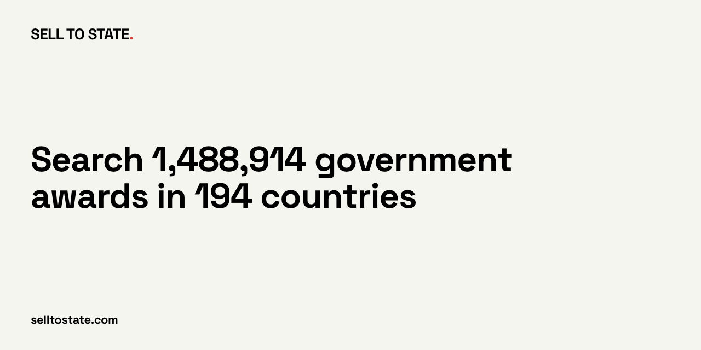

# Sell to State Rust client

Crate name is `selltostate`. Not published to crates.io. HTTPS calls use `curl` so the crate has no registry dependency.

Default base URL is `https://app.selltostate.com`. Send a dashboard key as the header `x-api-key`. Do not send that key as a bearer token. A machine client uses `Authorization: Bearer client:<id>`. Read `STS_API_KEY` and `STS_API_URL` only. A 401, 402, or 429 is not retried. A 402 exposes `payment_link`, `plan`, and `machine_payment`.

Create a key at the API keys link below. The documented prefix is `sts_`.

`amount_max` is in the spec. The REST awards route may ignore it. The client still sends the parameter.

## Also

- Site: [https://selltostate.com/?utm_source=github&utm_medium=referral&utm_campaign=sts-public-repos&utm_content=selltostate-rust](https://selltostate.com/?utm_source=github&utm_medium=referral&utm_campaign=sts-public-repos&utm_content=selltostate-rust)
- Countries: [https://selltostate.com/countries?utm_source=github&utm_medium=referral&utm_campaign=sts-public-repos&utm_content=selltostate-rust](https://selltostate.com/countries?utm_source=github&utm_medium=referral&utm_campaign=sts-public-repos&utm_content=selltostate-rust)
- Docs: [https://docs.selltostate.com/?utm_source=github&utm_medium=referral&utm_campaign=sts-public-repos&utm_content=selltostate-rust](https://docs.selltostate.com/?utm_source=github&utm_medium=referral&utm_campaign=sts-public-repos&utm_content=selltostate-rust)
- API keys: [https://app.selltostate.com/account/keys?utm_source=github&utm_medium=referral&utm_campaign=sts-public-repos&utm_content=selltostate-rust](https://app.selltostate.com/account/keys?utm_source=github&utm_medium=referral&utm_campaign=sts-public-repos&utm_content=selltostate-rust)
- X: https://x.com/selltostate
- https://github.com/getbeton/selltostate-api-reference
- https://github.com/getbeton/selltostate-mcp
- https://github.com/getbeton/selltostate-cli
- https://github.com/getbeton/selltostate-ts
- https://github.com/getbeton/selltostate-py
- https://github.com/getbeton/selltostate-java
- https://github.com/getbeton/selltostate-kotlin
- https://github.com/getbeton/selltostate-rust
- https://github.com/getbeton/selltostate-ror
- https://github.com/getbeton/selltostate-js
- https://github.com/getbeton/selltostate-node
- https://github.com/getbeton/selltostate-next

This package is not published to npm, PyPI, Maven Central, crates.io, RubyGems, or Homebrew.
